```python
import pandas as pd
import plotly.express as px
import plotly.graph_objects as go
import calendar

pd.options.display.float_format = '{:,.2f}'.format

sales = pd.read_parquet('data/sales.parquet')
cln_sales = pd.read_parquet('data/cln_sales.parquet')
custID_sales = pd.read_parquet('data/custID_sales.parquet')
no_custID_sales = pd.read_parquet('data/no_custID_sales.parquet')
cncld = pd.read_parquet('data/cncld.parquet')
```

  **Scope and data notes:** Online Retail II, Dec 2009 to 9 Dec 2011 (Dec 2011 is a partial month).
  Currency is £. `cln_sales` is gross sales: orders later cancelled or returned stay in, with
  cancellations tracked in `cncld`. Five lines across three orders (£284,623, ~1.4% of revenue)
  were removed in Cleaning.  
original dataset: https://www.kaggle.com/datasets/ozlemilgun/online-retail-dataset

# Analysis #  

## Business Overview ##  
_KPI cards, Revenue Trends Over Time, Cancellation Rate over Time_

### _KPI Cards_ ###  
total_revenue  
total_orders  
total_units_sold  
order_values  
avg_order_value  
med_order_value


```python
total_revenue = (cln_sales['Revenue']).sum()
total_orders = cln_sales['Invoice'].nunique()
total_units_sold = cln_sales['Quantity'].sum()

order_values = cln_sales.groupby('Invoice')['Revenue'].sum()
avg_order_value = order_values.mean()
med_order_value = order_values.median()
max_order_value = order_values.max()

print(f"Total Revenue: £{total_revenue:,.2f}")
print(f"Total Orders: {total_orders:,}")
print(f"Total Units Sold: {total_units_sold:,}")
print(f"Average Order Value: £{avg_order_value:,.2f}")
print(f"Median Order Value: £{med_order_value:,.2f}")
print(f"Max Order Value: £{max_order_value:,.2f}")
```

    Total Revenue: £19,359,238.44
    Total Orders: 39,513
    Total Units Sold: 11,032,791
    Average Order Value: £489.95
    Median Order Value: £301.20
    Max Order Value: £52,940.94
    

  **Finding:** Average order value is £489.95 but the median is £301.20, and the largest order is
  £52,940.94. A few very large orders pull the mean above the typical order, so the median is the better ‘typical order’ figure. Both are shown.

### _Revenue Trend over Time_ ###
monthly_rev_fig _'Monthly Revenue Trend'_  
yoy_fig _'Revenue by Month: Year-over-Year Comparison'_  
nov_fig _'November Daily Revenue by Year'_


```python
monthly_revenue = cln_sales.groupby('YearMonth')['Revenue'].sum().reset_index()

# Figure
monthly_rev_fig = px.line(monthly_revenue, x='YearMonth', y='Revenue', title='Monthly Revenue Trend')
monthly_rev_fig.update_yaxes(title='Revenue (£)')
monthly_rev_fig.update_xaxes(title='Month, Year')
monthly_rev_fig.show()
```


    
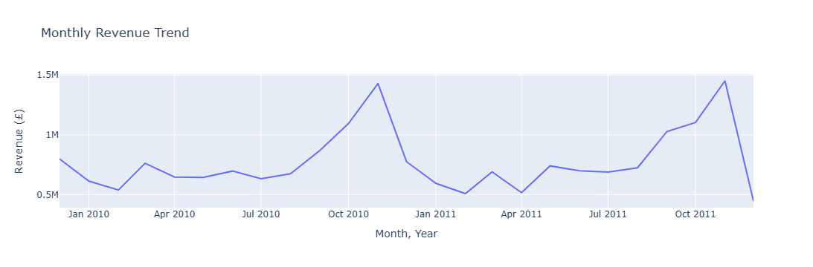
    


```python
# Monthly revenue stats: peak and low (excluding partial Dec 2011)
full_months = monthly_revenue[monthly_revenue['YearMonth'] != '2011-12']
peak = full_months.loc[full_months['Revenue'].idxmax()]
low = full_months.loc[full_months['Revenue'].idxmin()]
print(f"Peak month: {peak['YearMonth']} (£{peak['Revenue']:,.0f})")
print(f"Lowest full month: {low['YearMonth']} (£{low['Revenue']:,.0f})")
```

    Peak month: 2011-11 (£1,452,116)
    Lowest full month: 2011-02 (£507,800)
    

**Finding:** Revenue is seasonal, building from September into a November peak (£1.45M in Nov 2011, £1.43M in Nov 2010) and falling back sharply in December (as in Dec 2010). The lowest full month is Feb 2011 (£508K). December 2011 is a partial month (data ends 9 Dec), so its low point is not a real drop.


```python
month_order = list(calendar.month_name)[1:]

yoy_data = cln_sales.groupby(['Year', 'Month', 'MonthName'])['Revenue'].sum().reset_index()
yoy_data = yoy_data.sort_values('Month')

# Figure
yoy_fig = px.line(yoy_data, x='MonthName', y='Revenue', color='Year',
                  title='Revenue by Month: Year-over-Year Comparison',
                  markers=True,
                  category_orders={'MonthName': month_order})
yoy_fig.update_xaxes(title='Month')
yoy_fig.update_yaxes(title='Revenue (£)')
yoy_fig.show()
```


    
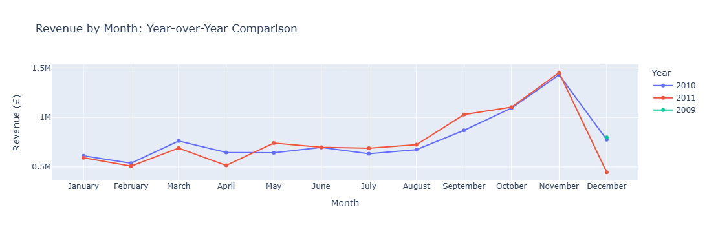
    


```python
# Year-over-year change, Jan-Nov (months covered in both years)
yoy_by_month = yoy_data[yoy_data['Month'] <= 11].pivot(index='Month', columns='Year', values='Revenue')
yoy_change = (yoy_by_month[2011] / yoy_by_month[2010] - 1) * 100
print("\nYoY change by month, 2011 vs 2010 (%):")
print(yoy_change.round(1).to_string())
print(f"Jan-Nov total: {(yoy_by_month[2011].sum() / yoy_by_month[2010].sum() - 1) * 100:+.1f}%")
print(f"Nov 2010: £{yoy_by_month.loc[11, 2010]:,.0f}")
```

    
    YoY change by month, 2011 vs 2010 (%):
    Month
    1     -3.10
    2     -5.60
    3     -9.40
    4    -20.30
    5     15.00
    6      0.30
    7      8.70
    8      7.40
    9     18.30
    10     0.80
    11     1.60
    Jan-Nov total: +1.7%
    Nov 2010: £1,429,701
    

**Finding:** Jan-Nov 2011 revenue is 1.7% above the same months of 2010. The year started behind (Jan-Apr down 3% to 20%, with April the weakest at -20.3%), then ran ahead in May (+15.0%) and from July through September (+8.7%, +7.4%, +18.3%), with June flat (+0.3%). October (+0.8%) and November (+1.6%) are close to flat, so the holiday peak was about the same size both years. December 2011 is partial (to 9 Dec) and is excluded.

### _Cancellation Rate Over Time_ ###  
cncl_rate_fig _'Order Cancellation Rate over Time'_


```python
# Order cancellation rate = cancelled invoices / (completed + cancelled invoices), by month.
# Uses `sales` (not `cln_sales`) for completed orders: cln_sales drops zero/negative price/quantity rows which would shrink the denominator.

cncld_by_month = cncld.groupby('YearMonth')['Invoice'].nunique().reset_index(name='Cancelled_Orders')
sales_by_month = sales.groupby('YearMonth')['Invoice'].nunique().reset_index(name='Completed_Orders')

cancellation_trend = pd.merge(sales_by_month, cncld_by_month, on='YearMonth', how='outer').fillna(0)
cancellation_trend['All_Orders'] = cancellation_trend['Completed_Orders'] + cancellation_trend['Cancelled_Orders']
cancellation_trend['Cancellation_Rate_%'] = (cancellation_trend['Cancelled_Orders'] / cancellation_trend['All_Orders']) * 100
cancellation_trend = cancellation_trend.sort_values('YearMonth')

rate = cancellation_trend.set_index('YearMonth')['Cancellation_Rate_%']
print(f"Cancellation rate: min {rate.min():.1f}% ({rate.idxmin()}), max {rate.max():.1f}% ({rate.idxmax()})")
print(f"Average 2010: {rate[rate.index.str.startswith('2010')].mean():.1f}% | "
      f"Average 2011: {rate[rate.index.str.startswith('2011')].mean():.1f}%")
```

    Cancellation rate: min 11.9% (2011-11), max 17.1% (2011-01)
    Average 2010: 15.0% | Average 2011: 13.9%
    


```python
# Figure
cncl_rate_fig = px.line(cancellation_trend, x='YearMonth', y='Cancellation_Rate_%',
                        title='Order Cancellation Rate over Time', markers=True)
cncl_rate_fig.update_yaxes(title='Order Cancellation Rate (%)')
cncl_rate_fig.update_xaxes(title='Month, Year')
cncl_rate_fig.show()
```


    
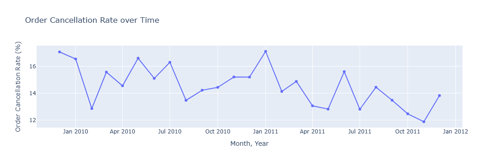
    


**Finding:** Between 12% and 17% of monthly orders are cancelled. The rate is volatile month to month but trending down: it averaged 15.0% in 2010 and 13.9% in 2011, with a high of 17.1% (Jan 2011) and a low of 11.9% (Nov 2011). December 2011 is partial.

## Products & Markets ##

### _Top Products by Revenue vs. Top Products by Units Sold_ ###
rev_bar_fig _'Top 10 Products by Revenue'_   
units_bar_fig _'Top 10 Products by Units Sold'_  


```python
top10_prod_by_rev = (
    cln_sales.groupby(['StockCode', 'Description'])['Revenue']
    .sum()
    .reset_index()
    .sort_values('Revenue', ascending=False)
    .head(10)
)

top10_prod_by_units_sold = (
    cln_sales.groupby(['StockCode', 'Description'])['Quantity']
    .sum()
    .reset_index()
    .sort_values('Quantity', ascending=False)
    .head(10)
)

# Figures
rev_bar_fig = px.bar(top10_prod_by_rev, x='Revenue', y='Description', orientation='h',
                     title='Top 10 Products by Revenue')
rev_bar_fig.update_yaxes(categoryorder='total ascending', title='Product Description')
rev_bar_fig.update_xaxes(title='Revenue (£)', tickformat=',.0f')
rev_bar_fig.show()

units_bar_fig = px.bar(top10_prod_by_units_sold, x='Quantity', y='Description', orientation='h',
                       title='Top 10 Products by Units Sold')
units_bar_fig.update_yaxes(categoryorder='total ascending', title='Product Description')
units_bar_fig.update_xaxes(title='Units Sold', tickformat=',d')
units_bar_fig.show()
```


    
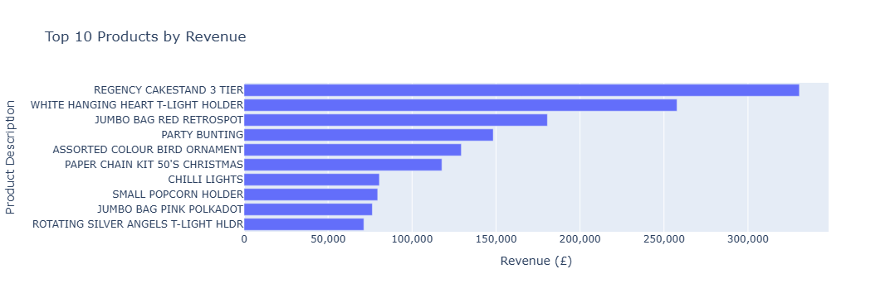
    


    
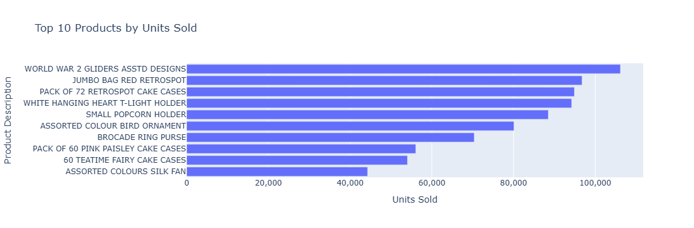
    


**Finding:** Four products rank in the top 10 for both revenue and units: jumbo bag red retrospot, white hanging heart T-light holder, small popcorn holder and assorted colour bird ornament. Revenue leaders are mostly giftware and seasonal decor (regency cakestand, T-light holders, party bunting, Christmas paper chain). Unit leaders are lower-priced items (WW2 gliders, cake cases, popcorn holders, fans). Best sellers by revenue are not the best by volume.

### _Pareto chart: Cumulative Revenue % by Product Rank_ ###  
pareto_fig _'Pareto Analysis: Cumulative Revenue % by Product Rank (Top 50)'_


```python
# Ranking products by total revenue
product_revenue = (
    cln_sales.groupby(['StockCode', 'Description'])['Revenue']
    .sum()
    .sort_values(ascending=False)
    .reset_index()
)

product_revenue['Rank'] = product_revenue.index + 1
product_revenue['Revenue_%'] = product_revenue['Revenue'] / product_revenue['Revenue'].sum() * 100
product_revenue['Cumulative_%'] = product_revenue['Revenue_%'].cumsum()

# Concentration stats
n_products = len(product_revenue)
n_products_80pct = (product_revenue['Cumulative_%'] < 80).sum() + 1
pct_of_catalog = n_products_80pct / n_products * 100

n_top_1pct_prod = int(n_products * 0.01)
best = product_revenue.iloc[0]
best_share = best['Revenue_%']
top10_share = product_revenue['Cumulative_%'].iloc[9]
top1pct_share = product_revenue['Cumulative_%'].iloc[n_top_1pct_prod - 1]

print(f"Products to reach 80% of revenue: {n_products_80pct:,} of {n_products:,} ({pct_of_catalog:.1f}% of catalog)")
print(f"Best seller by revenue: {best['Description']} ({best['StockCode']}), "
      f"£{best['Revenue']:,.2f} = {best_share:.1f}% of revenue")
print(f"Top 10 products = {top10_share:.1f}% of revenue")
print(f"Top 1% ({n_top_1pct_prod} products) = {top1pct_share:.1f}% of revenue")
```

    Products to reach 80% of revenue: 1,053 of 4,895 (21.5% of catalog)
    Best seller by revenue: REGENCY CAKESTAND 3 TIER (22423), £330,590.32 = 1.7% of revenue
    Top 10 products = 7.6% of revenue
    Top 1% (48 products) = 18.4% of revenue
    


```python
# Figure
top_n = 50  # top 50 shown for readability; 80% is reached further right
plot_data = product_revenue.head(top_n)

pareto_fig = go.Figure()
pareto_fig.add_trace(go.Bar(
    x=plot_data['Rank'], y=plot_data['Revenue'],
    name='Revenue', marker_color='steelblue'
))
pareto_fig.add_trace(go.Scatter(
    x=plot_data['Rank'], y=plot_data['Cumulative_%'],
    name='Cumulative %', yaxis='y2',
    mode='lines+markers', line=dict(color='firebrick')
))
pareto_fig.add_hline(y=80, line_dash='dash', line_color='gray', yref='y2')
pareto_fig.update_layout(
    title=f'Pareto Analysis: Cumulative Revenue % by Product Rank (Top {top_n})',
    height=500,
    margin=dict(t=80, r=80, b=120),
    legend=dict(orientation='h', yanchor='top', y=-0.2, xanchor='center', x=0.5),
    yaxis=dict(title='Revenue (£)', tickformat=',.0f'),
    yaxis2=dict(title='Cumulative % of Revenue', overlaying='y', side='right', range=[0, 100])
)
pareto_fig.update_xaxes(title='Product Rank', range=[0.5, top_n + 0.5])
pareto_fig.add_annotation(
    x=top_n * 0.45, y=80, yref='y2', xanchor='left', yanchor='bottom', showarrow=False,
    text=f'80% of revenue is reached at product {n_products_80pct:,} (off this chart)'
)

pareto_fig.show()
```


    
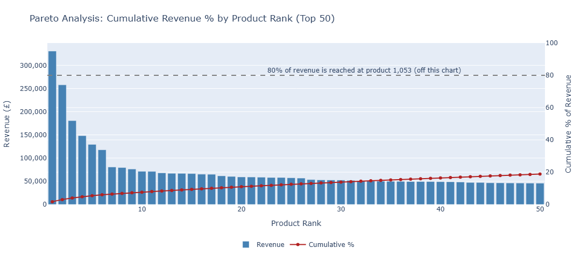
    


**Finding:** Product revenue follows roughly the classic 80/20 pattern: it takes **1,053 products
(21.5% of the 4,895-product catalog)** to reach 80% of revenue. No single product dominates, since
the top product by revenue (Regency Cakestand 3 Tier) is only 1.7% of revenue, but the top 10 products
(0.2% of the catalog) still account for 7.6% and the top 1% (48 products)
for 18.4%.

### _Revenue by Country_ ###
UK / Intl Revenue Comparison Cards (tot_uk_rev, tot_intl_rev)  
intl_rev_bar_fig _'International Revenue by Country (Top 15, excluding UK)'_


```python
# Revenue by country
rev_by_country = (cln_sales.groupby('Country')['Revenue'].sum()
                  .sort_values(ascending=False).reset_index())
intl_rev = rev_by_country[rev_by_country['Country'] != 'United Kingdom'].reset_index(drop=True)

# UK vs. international
tot_uk_rev = rev_by_country.loc[rev_by_country['Country'] == 'United Kingdom', 'Revenue'].iloc[0]
tot_intl_rev = intl_rev['Revenue'].sum()
uk_pct = tot_uk_rev / (tot_uk_rev + tot_intl_rev) * 100
intl_pct = 100 - uk_pct

# International markets outside the chart
top_n_intl = 15
other_pct = intl_rev.iloc[top_n_intl:]['Revenue'].sum() / tot_intl_rev * 100

print(f"UK Revenue: £{tot_uk_rev:,.2f} ({uk_pct:.1f}%)")
print(f"International Revenue: £{tot_intl_rev:,.2f} ({intl_pct:.1f}%)")
print(f"Countries outside the top {top_n_intl}: {other_pct:.1f}% of international revenue")

# Figure
intl_rev_bar_fig = px.bar(intl_rev.head(top_n_intl), x='Country', y='Revenue',
                          title=f'International Revenue by Country (Top {top_n_intl}, excluding UK)')
intl_rev_bar_fig.update_yaxes(title='Revenue (£)', tickformat=',.0f')
intl_rev_bar_fig.update_xaxes(title='Country', tickangle=-45)
intl_rev_bar_fig.show()
```

    UK Revenue: £16,516,396.19 (85.3%)
    International Revenue: £2,842,842.25 (14.7%)
    Countries outside the top 15: 7.1% of international revenue
    


    
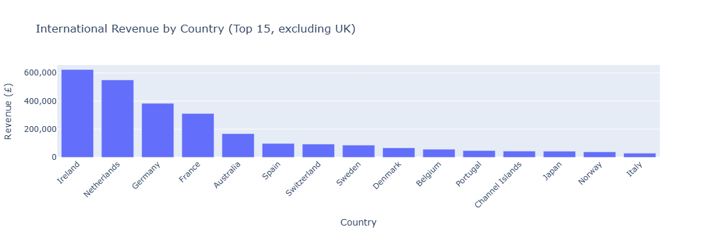
    


**Finding:** The UK is 85.3% of revenue (£16.52M); international is 14.7% (£2.84M). Ireland (£623K) and the Netherlands (£550K) lead international sales, together ~41% of it. Germany and France bring the top four to ~66%. Countries outside the top 15 together make up 7.1% of international revenue.

## Customers & Orders ##  

### _Order Size Distribution_ ###   
orderSize_dist_fig _'Distribution of Units per Order (95% of Orders, up to 800 units)'_


```python
units_per_order = cln_sales.groupby('Invoice')['Quantity'].sum().reset_index()
qty = units_per_order['Quantity']

# Display settings: cap is roughly the 95th percentile
cap = 800
bin_size = 50
n_excluded = (qty > cap).sum()
excluded_pct = n_excluded / len(qty) * 100

print(f"Median: {qty.median():,.0f} units | Mean: {qty.mean():,.0f} | 95th percentile: {qty.quantile(0.95):,.0f}")
print(f"{excluded_pct:.1f}% of orders ({n_excluded:,}) exceed {cap} units and fall outside "
      f"the displayed range (largest order: {qty.max():,} units)")

# Figure
orderSize_dist_fig = px.histogram(
    units_per_order, x='Quantity', opacity=0.75,
    title=f'Distribution of Units per Order ({100 - excluded_pct:.0f}% of Orders, up to {cap} Units)'
)
orderSize_dist_fig.update_traces(xbins=dict(size=bin_size))
orderSize_dist_fig.update_xaxes(title='Units per Order', range=[0, cap], dtick=bin_size,
                                tickangle=-45, showgrid=True, gridcolor='lightgray')
orderSize_dist_fig.update_yaxes(title='Number of Orders')
orderSize_dist_fig.show()
```

    Median: 148 units | Mean: 279 | 95th percentile: 793
    4.9% of orders (1,940) exceed 800 units and fall outside the displayed range (largest order: 87,167 units)
    


    
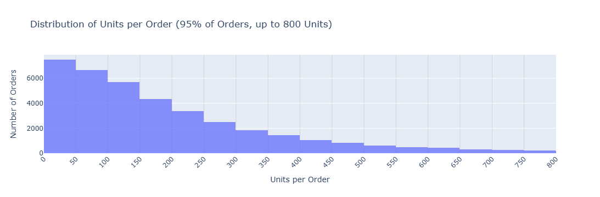
    


  **Finding:** The typical order is about 148 units (median); the mean is 279, pulled up by a long tail of bulk orders. 95% of orders are under 800 units, and the largest is 87,167 units. The chart is capped at 800 units for readability, which leaves out 4.9% of orders (1,940), consistent with bulk or wholesale-style buying.

### _Known Customers vs. No Customer ID_ ###
_(Orders with no Customer ID are called "No Customer ID" in labels and notes. The source doesn't
document why the ID is missing, so the group may mix guest checkouts, other sales channels, and
batch invoices.)_

cust_split_fig _'Known Customer vs. No Customer ID: Share of Revenue and Orders'_


```python
# Revenue and order split: known customers vs. orders with no Customer ID
noid_rev = no_custID_sales['Revenue'].sum()
n_noid_orders = no_custID_sales['Invoice'].nunique()
noid_pcnt_total_rev = noid_rev / total_revenue * 100
noid_pcnt_total_orders = n_noid_orders / total_orders * 100

known_rev = custID_sales['Revenue'].sum()
n_known_orders = custID_sales['Invoice'].nunique()
known_pcnt_total_rev = known_rev / total_revenue * 100
known_pcnt_total_orders = n_known_orders / total_orders * 100

# Sanity checks: the two groups should account for everything
assert abs(noid_rev + known_rev - total_revenue) < 0.01
assert n_noid_orders + n_known_orders == total_orders

print(f"Known Customer Revenue: £{known_rev:,.2f} ({known_pcnt_total_rev:.1f}% of total revenue)")
print(f"No Customer ID Revenue: £{noid_rev:,.2f} ({noid_pcnt_total_rev:.1f}% of total revenue)")
print(f"Known Customer Orders:  {n_known_orders:,} ({known_pcnt_total_orders:.1f}% of total orders)")
print(f"No Customer ID Orders:  {n_noid_orders:,} ({noid_pcnt_total_orders:.1f}% of total orders)")
```

    Known Customer Revenue: £16,783,959.54 (86.7% of total revenue)
    No Customer ID Revenue: £2,575,278.90 (13.3% of total revenue)
    Known Customer Orders:  36,591 (92.6% of total orders)
    No Customer ID Orders:  2,922 (7.4% of total orders)
    


```python
cust_split_df = pd.DataFrame({
    'Metric': ['Revenue', 'Revenue', 'Orders', 'Orders'],
    'Customer_Type': ['Known', 'No Customer ID', 'Known', 'No Customer ID'],
    'Percent': [known_pcnt_total_rev, noid_pcnt_total_rev,
                known_pcnt_total_orders, noid_pcnt_total_orders]
})

# Figure
cust_split_fig = px.bar(cust_split_df, x='Metric', y='Percent', color='Customer_Type', barmode='group',
                        title='Known Customer vs. No Customer ID: Share of Revenue and Orders',
                        text=cust_split_df['Percent'].round(1).astype(str) + '%')
cust_split_fig.update_yaxes(title='% of Total')
cust_split_fig.show()
```


    
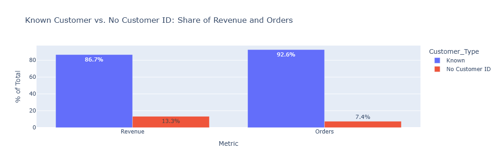
    


**Finding:** Orders with no customer ID are 7.4% of orders but 13.3% of revenue (£2.58M of
£19.36M). Their average order value is therefore above the overall average (see next cell).


```python
# AOV and basket size: no Customer ID vs. known customers
def order_metrics(df):
    """One row per order: value (£), total units, and distinct products."""
    return df.groupby('Invoice').agg(
        order_value=('Revenue', 'sum'),
        units_per_order=('Quantity', 'sum'),
        products_per_order=('StockCode', 'nunique')
    )

noid_orders_df = order_metrics(no_custID_sales)
known_orders_df = order_metrics(custID_sales)

comparison = pd.DataFrame({
    'No ID (mean)': noid_orders_df.mean(),
    'Known (mean)': known_orders_df.mean(),
    'No ID (median)': noid_orders_df.median(),
    'Known (median)': known_orders_df.median()
})
comparison['No ID vs Known (median, %)'] = (
    (comparison['No ID (median)'] - comparison['Known (median)'])
    / comparison['Known (median)'] * 100
)
comparison.index = ['Order Value (£)', 'Units per Order', 'Distinct Products per Order']

print(comparison.round(2))
```

                                 No ID (mean)  Known (mean)  No ID (median)  \
    Order Value (£)                    881.34        458.69          183.79   
    Units per Order                    235.90        282.68           39.00   
    Distinct Products per Order         77.33         20.94           19.50   
    
                                 Known (median)  No ID vs Known (median, %)  
    Order Value (£)                      302.54                      -39.25  
    Units per Order                      153.00                      -74.51  
    Distinct Products per Order           15.00                       30.00  
    

**Finding:** The typical (median) no-ID order is smaller than a known-customer order: £184 vs.
£303 in value, and 39 vs. 153 units. But no-ID orders contain more distinct products (median
19.5 vs. 15), and their *average* order value is much higher (£881 vs. £459). Mean and median
disagree because the no-ID group has a heavy upper tail (see next cell). Medians describe the typical
order, so they lead on the dashboard, with means shown alongside.


```python
# How much of no-ID revenue comes from the largest invoices?
noid_vals = noid_orders_df['order_value'].sort_values(ascending=False)
n_top_1pct_orders = max(1, int(len(noid_vals) * 0.01))

print(f"Top 10 no-ID orders = {noid_vals.head(10).sum() / noid_vals.sum() * 100:.1f}% of no-ID revenue")
print(f"Top 1% ({n_top_1pct_orders} orders) = {noid_vals.head(n_top_1pct_orders).sum() / noid_vals.sum() * 100:.1f}% of no-ID revenue")

trimmed = noid_vals.iloc[n_top_1pct_orders:]
print(f"No-ID mean excluding top 1%: £{trimmed.mean():,.2f} (median £{trimmed.median():,.2f})")
```

    Top 10 no-ID orders = 11.7% of no-ID revenue
    Top 1% (29 orders) = 17.8% of no-ID revenue
    No-ID mean excluding top 1%: £731.66 (median £175.90)
    

**Finding:** The no-ID group's high average is not caused by a few outliers alone. The top 1% of orders (29 invoices) make up 17.8% of no-ID revenue, and the mean is still £732 (median £176) after removing them. The group includes some very large bulk invoices and some unusually wide baskets (hundreds of distinct products), neither of which looks like an individual shopper checking out. The source data doesn't document what these invoices represent.

### _Top Customers by Revenue (Known Customers only)_ ###  
top_cust_fig _'Top 10 Known Customers by Revenue'_


```python
# Revenue by known customer, ranked
customer_rev = (
    custID_sales.groupby('Customer ID')
    .agg(Revenue=('Revenue', 'sum'),
         Orders=('Invoice', 'nunique'),
         Units=('Quantity', 'sum'),
         Country=('Country', 'first'))
    .sort_values('Revenue', ascending=False)
    .reset_index()
)

customer_rev['Rank'] = customer_rev.index + 1
customer_rev['AOV'] = customer_rev['Revenue'] / customer_rev['Orders']
customer_rev['Pct_of_Known_Rev'] = customer_rev['Revenue'] / known_rev * 100
customer_rev['Pct_of_Total_Rev'] = customer_rev['Revenue'] / total_revenue * 100
customer_rev['Cumulative_%'] = customer_rev['Pct_of_Known_Rev'].cumsum()
```


```python
n_customers = len(customer_rev)
n_top_1pct_cust = max(1, int(n_customers * 0.01))
n_top_10pct_cust = int(n_customers * 0.10)
n_to_80 = (customer_rev['Cumulative_%'] < 80).sum() + 1
top10 = customer_rev.head(10)

print(f"Known customers: {n_customers:,}")
print(f"Top 10 customers = {top10['Pct_of_Known_Rev'].sum():.1f}% of known-customer revenue "
      f"({top10['Pct_of_Total_Rev'].sum():.1f}% of total revenue)")
print(f"Top 1% ({n_top_1pct_cust} customers) = {customer_rev.head(n_top_1pct_cust)['Pct_of_Known_Rev'].sum():.1f}%")
print(f"Top 10% ({n_top_10pct_cust} customers) = {customer_rev.head(n_top_10pct_cust)['Pct_of_Known_Rev'].sum():.1f}%")
print(f"Customers needed to reach 80% of known-customer revenue: {n_to_80:,} ({n_to_80 / n_customers * 100:.1f}% of customers)")

print()
print(top10[['Customer ID', 'Country', 'Orders', 'AOV']]
      .to_string(index=False, formatters={'AOV': '{:,.0f}'.format}))
```

    Known customers: 5,852
    Top 10 customers = 16.2% of known-customer revenue (14.0% of total revenue)
    Top 1% (58 customers) = 31.3%
    Top 10% (585 customers) = 63.3%
    Customers needed to reach 80% of known-customer revenue: 1,374 (23.5% of customers)
    
     Customer ID        Country  Orders   AOV
           18102 United Kingdom     145 4,007
           14646    Netherlands     145 3,633
           14156        Ireland     144 2,105
           14911        Ireland     373   730
           17450 United Kingdom      51 4,800
           13694 United Kingdom     143 1,368
           17511 United Kingdom      60 2,869
           16684 United Kingdom      55 2,675
           12415      Australia      24 6,001
           15061 United Kingdom     127   995
    


```python
top10_cust = customer_rev.head(10).copy()
top10_cust['Customer'] = 'ID ' + top10_cust['Customer ID'].astype(str)

# Figure
top_cust_fig = px.bar(top10_cust, x='Revenue', y='Customer', orientation='h',
                      title='Top 10 Known Customers by Revenue',
                      hover_data={'Country': True, 'Orders': True, 'AOV': ':,.0f', 'Customer': False})
top_cust_fig.update_yaxes(categoryorder='total ascending', title='Customer ID')
top_cust_fig.update_xaxes(title='Revenue (£)', tickformat=',.0f')
top_cust_fig.show()
```


    
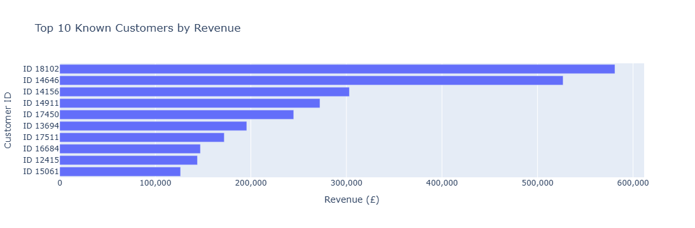
    


**Finding:** Known-customer revenue is concentrated at the top. The top 10 customers account for
16.2% of known-customer revenue (about 14% of total revenue), the top 1% (58 customers) for 31.3%,
and the top 10% (585) for 63.3%. It takes 1,374 customers (23.5% of the 5,852 base) to reach 80%,
similar to the product pattern (1,053 products, 21.5% of the catalog), but the top of the
distribution is heavier. Eight of the top ten placed 55 or more orders, at average values of £730
to £4,000, well above the known-customer median order of £303, so they are repeat bulk buyers, not
one-off wholesale purchasers. The exceptions are customers 17450 (51 orders, about £4,800 each) and
12415 (Australia, 24 orders, about £6,000 each). A small group of repeat buyers carries a
large share of revenue, so retaining them is important.

### _Simple repeat-purchase rate (% of known customers with >1 order)_ ###  
order_buckets_fig _'Known Customers by Number of Orders'_


```python
orders_per_cust = custID_sales.groupby('Customer ID')['Invoice'].nunique()

n_known_cust = len(orders_per_cust)
n_onetime = (orders_per_cust == 1).sum()
onetime_rate = n_onetime / n_known_cust * 100
n_repeat = (orders_per_cust > 1).sum()
repeat_rate = n_repeat / n_known_cust * 100

print(f"Known Customers: {n_known_cust:,}")
print(f"One-Time Customers: {n_onetime:,}, {onetime_rate:,.1f}%")
print(f"Repeat Customers (2+ orders): {n_repeat:,}, {repeat_rate:,.1f}%")
print(f"Median orders per customer: {orders_per_cust.median():.0f} (mean {orders_per_cust.mean():.1f})")
```

    Known Customers: 5,852
    One-Time Customers: 1,619, 27.7%
    Repeat Customers (2+ orders): 4,233, 72.3%
    Median orders per customer: 3 (mean 6.3)
    


```python
order_buckets = (orders_per_cust.clip(upper=10).value_counts().sort_index().reset_index())
order_buckets.columns = ['Orders', 'Customers']
order_buckets['Orders'] = order_buckets['Orders'].astype(str).replace({'10': '10+'})

assert order_buckets['Customers'].sum() == n_known_cust

# Figure
order_buckets_fig = px.bar(order_buckets, x='Orders' , y='Customers' , title='Known Customers by Number of Orders',
                          text='Customers')
order_buckets_fig.update_xaxes(title='Orders Placed', type='category')
order_buckets_fig.update_yaxes(title='Number of Customers')
order_buckets_fig.show()
```


    
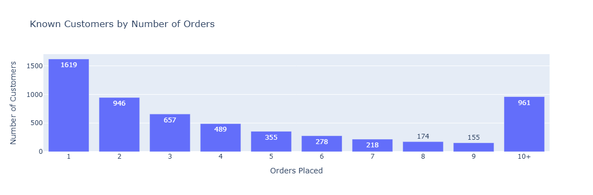
    


**Finding:** 72.3% of known customers (4,233 of 5,852) placed more than one order; 27.7% (1,619) bought once. The typical customer placed 3 orders (median), while the mean is 6.3, pulled up by a small group of very frequent buyers. This is a repeat-heavy customer base, which fits the earlier finding that a small group of repeat buyers carries a large share of revenue. Caveat: the dataset covers only about two years and customers who first ordered late in 2011 had little time to reorder, so the true repeat rate is likely slightly higher.

## Summary
- **Revenue:** £19.36M across 39,513 orders and 11.0M units. Median order £301 (mean £490, pulled up by large orders).
- **Seasonality:** Revenue builds into a November peak every year.
- **Products:** 80% of revenue comes from 21.5% of products (1,053 of 4,895), with no single product above 1.7%.
- **Customers:** Known customers are 86.7% of revenue; the top 1% of them hold 31.3%. 72.3% of known customers order more than once.
- **Markets:** UK 85.3% of revenue.
- **Cancellations:** 12-17% of orders per month, drifting down.
