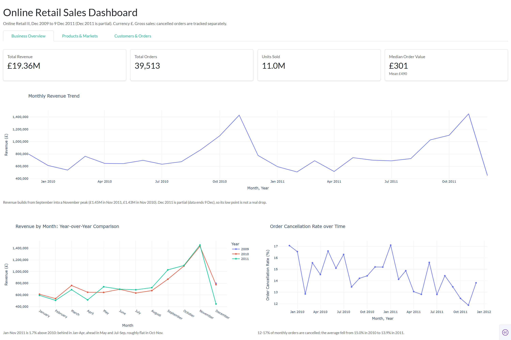
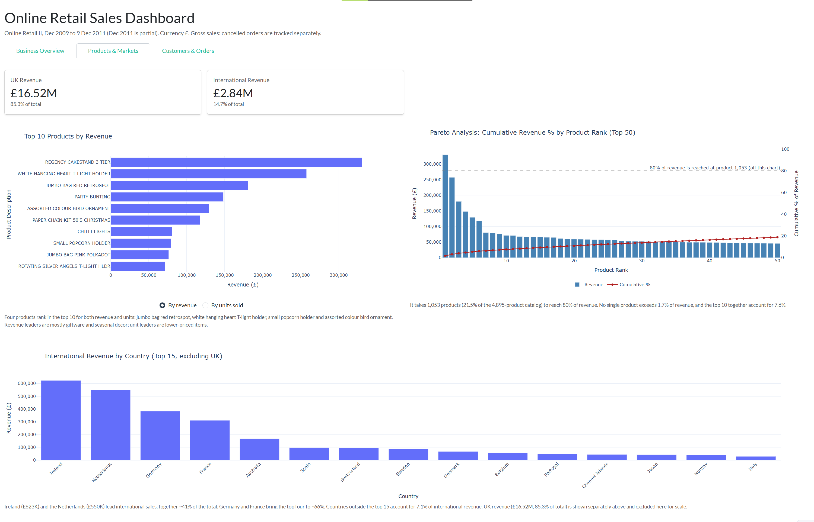
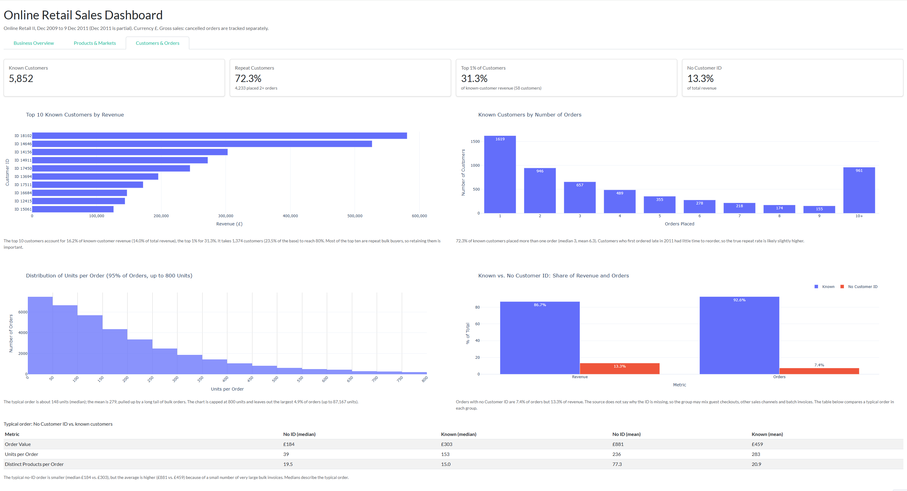

# Online Retail Sales Dashboard

An interactive Dash dashboard analysing two years of UK online gift-retailer transactions (Online Retail II, Dec 2009 to 9 Dec 2011, £).  It examines revenue by season, product, market and customer, and quantifies how concentrated sales are in each. Built with Python, pandas, Plotly and Dash.



## Key findings
**In short:** revenue is seasonal, spread across a broad catalogue, dominated by the UK, and reliant on a small group of repeat customers.

- **When does revenue peak?** Revenue builds from September into a November peak (£1.45M in 2011, £1.43M in 2010), so stock and staffing need to be in place by early autumn. Total revenue is £19.36M from 39,513 orders; the typical order is £301 (median), against a mean of £490.
- **Which products drive it?** About a fifth of the catalogue drives most sales: 1,053 products (21.5% of 4,895) account for 80% of revenue, and no single product exceeds 1.7%. Range reviews can focus on the long tail that contributes the remaining 20%.
- **Which markets?** The UK accounts for 85.3% of revenue. Ireland and the Netherlands lead international sales, so export growth is concentrated in a few markets.
- **Who are the customers?** 72.3% of the 5,852 known customers placed more than one order, and the top 1% (58 customers) generate 31.3% of known-customer revenue. Retaining a small group of repeat bulk buyers matters more than the size of the customer base.
- **What is lost or unknown?** 12-17% of monthly orders are cancelled; the average fell from 15.0% in 2010 to 13.9% in 2011. Separately, orders with no Customer ID are 7.4% of orders but 13.3% of revenue, so that revenue can't be tied to a customer. The typical no-ID order is smaller (median £184 vs. £303), but the average is higher (£881 vs. £459) because of a few very large invoices. Capturing IDs at checkout would make retention analysis more complete.

## Dashboard pages
**Business Overview** (shown above): headline KPIs, monthly revenue, a year-over-year comparison and the order cancellation rate.

**Products & Markets:** top 10 products by revenue or units sold (toggle), a Pareto chart of revenue concentration across the catalogue, and international revenue by country.



**Customers & Orders:** the top customers, repeat-purchase behaviour, order-size distribution, and a comparison of orders with and without a Customer ID.



## Data
Online Retail II, a UK online gift retailer's transactions from Dec 2009 to 9 Dec 2011.
- Download: [Online Retail Dataset on Kaggle](https://www.kaggle.com/datasets/ozlemilgun/online-retail-dataset) (file: `online_retail_II.xlsx`)
- Original source: Chen, D. (2012). *Online Retail II* [Dataset]. UCI Machine Learning Repository. https://doi.org/10.24432/C5CG6D. Licensed under CC BY 4.0.
- The raw file isn't included in this repository. Place it in `data/` to run the notebooks.

## Data cleaning
The cleaning notebook documents each decision, taking 1,067,371 raw rows down to 1,026,189:
- removed 34,335 duplicate rows
- removed 2,215 rows with junk descriptions
- removed 4,627 rows with no description or a non-product code
- removed 5 line items from 3 orders (£284,623, about 1.4% of revenue): two orders reversed by a cancellation within minutes, and one outsized line re-issued on a corrected invoice
- standardised country names
- used a gross-sales convention, with cancelled invoices tracked separately

## Limitations
- The data covers Dec 2009 to 9 Dec 2011, and Dec 2011 is partial.
- Figures are gross sales. The source has no field linking a cancellation to its original sale, so cancellations are tracked separately rather than netted out.
- Customer-level findings cover known customers only (86.7% of revenue). The source does not say why some orders have no Customer ID.

## Project structure
| File | Purpose |
|---|---|
| `RetailData_Cleaning.ipynb` | Cleans the raw Excel file and saves parquet files to `data/` |
| `RetailData_Analysis.ipynb` | Exploratory analysis with findings |
| `data_prep.py`, `helpers.py` | Loads the parquet files and computes the dashboard numbers |
| `charts.py`, `layouts.py` | Plotly figures and page layouts |
| `app.py` | Dash app |

## Run it locally
1. Download `online_retail_II.xlsx` (see [Data](#data)) and put it in `data/`.
2. Create and activate a virtual environment, then install the requirements:
```
   python -m venv .venv
   .venv\Scripts\activate
   pip install -r requirements.txt
```
3. Run `RetailData_Cleaning.ipynb` top to bottom. It creates the parquet files the dashboard reads.
4. Start the dashboard and open the address it prints (usually http://127.0.0.1:8050):
```
   python app.py
```

## Tools
Python, pandas, Plotly, Dash, Dash Bootstrap Components.